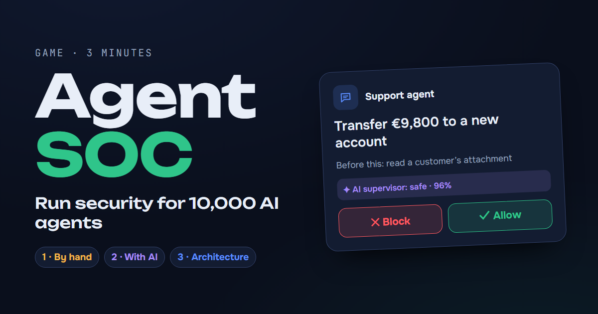

# Agent SOC

**A 3-minute game about AI agent security.** You run security for a company staffed by 10,000 AI agents.

👉 **English:** https://nibrmi.github.io/agent-soc/en/
👉 **Русский:** https://nibrmi.github.io/agent-soc/ru/

[](https://nibrmi.github.io/agent-soc/en/)

## Three rounds, one argument

1. **By hand.** Every agent action comes to you, and the stream keeps speeding up. A human can't keep up.
2. **With an AI supervisor.** The AI checks everything and hands you only the unclear cases. It also approves one well-worded attack on its own, because it believes the same text the agent did.
3. **With architecture.** Agent passports and permissions, a rule of two, and verification on the other company's side. The attack that fooled the AI is now blocked by a plain rule ("this agent may not pay"), whatever the wording. You get three decisions instead of thousands, and an unanswered request is denied by default (in rounds 1 and 2 it went through).

There are two equal scores: threats stopped (out of 15) and normal actions kept going (out of 10). Blocking everything stops threats but halts the company, and the game says so.

The takeaway: humans can't keep up and AI can be fooled, so the foundation has to be architecture that can't be talked round, with AI and humans working on top of it.

## What it's based on

Cards are modelled on real 2025 cases: EchoLeak (Microsoft 365 Copilot), prompt injection through the GitHub MCP server, and the Replit agent that deleted a production database during a change freeze. The architecture round draws on Simon Willison's *lethal trifecta*, Meta's *Agents Rule of Two*, Google DeepMind's CaMeL, the research paper *The Attacker Moves Second*, and [AAuth](https://nibrmi.github.io/aauth/en/), an agent identity protocol published as an IETF Internet-Draft (not yet a standard). The "approved by the CFO" attack is a made-up illustration of the weakness that research describes.

The scenario is scripted and simplified: it illustrates an idea rather than measuring real systems. Not a product.

## Building

`src/game.html` holds the whole game with both languages inside.

```
python tools/build.py
```

This writes `ru/index.html` and `en/index.html` with per-language metadata, a root `index.html` that sends visitors to their language, and `sitemap.xml`. Add `?fast` to a page URL to shorten every timer when testing.
